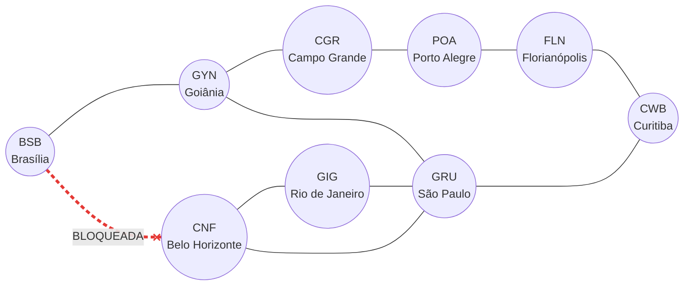

# Grafos, BFS e DFS: conectividade em uma rede fictícia de cidades

**Disciplina:** Estrutura de Dados II (Ciência da Computação)  
**Estudante:** Gustavo Alves  
**Material:** *Material do Estudante: Grafos, BFS e DFS* (`Material_Estudante_Grafos_BFS_DFS.md`)  
**Referência principal:** GOMES, Paulo César Rodacki. *Grafos: conceitos fundamentais, algoritmos e aplicações*. Blumenau: Editora IFC, 2022.

> **Importante:** esta atividade é uma simulação computacional, e não um modelo de navegação aeronáutica. A notícia da pane de GPS no Aeroporto de Brasília (G1, 22 set. 2026) motiva o problema, mas a rede, as conexões e os bloqueios são **fictícios**. O resultado não pode ser usado para orientar voos reais.

Este arquivo reúne tudo em um só lugar: modelagem, código, experimentos, comparação, reflexão e testes. Os blocos de código formam **um único programa Python, para ser executado na ordem em que aparecem** (copie-os em um arquivo `.py` ou em células do Google Colab). As saídas mostradas abaixo de cada bloco foram obtidas dessa execução.

## 1. Problema e objetivo

Uma indisponibilidade de recursos de navegação pode obrigar a replanejar rotas. Para estudar esse tipo de situação, a rede é modelada como um grafo e são comparados dois algoritmos de busca, a BFS (busca em largura) e a DFS (busca em profundidade).

**Pergunta de pesquisa:** *como a BFS e a DFS se comportam quando a conexão BSB–CNF (Brasília–Belo Horizonte) é bloqueada?*

**Objetivo:** projetar um grafo próprio com pelo menos sete vértices, implementar BFS e DFS em Python, simular bloqueios de conexões sem alterar a rede original e justificar os resultados.

## 2. Modelagem do grafo

Grafo simples, **não dirigido** e **não ponderado**, `G = (V, E)`:

- cada vértice em `V` é uma cidade;
- cada aresta em `E` é uma ligação permitida nos dois sentidos;
- não há laços nem conexões repetidas (o programa rejeita laços e ignora repetições).

**V** (9 cidades): Brasília (BSB), Goiânia (GYN), Belo Horizonte (CNF), Campo Grande (CGR), São Paulo (GRU), Rio de Janeiro (GIG), Curitiba (CWB), Porto Alegre (POA) e Florianópolis (FLN). Os códigos IATA são usados como rótulos no diagrama; os nomes completos permanecem no código para facilitar a leitura.

| # | Conexão | Justificativa (fictícia) |
|---:|---|---|
| 1 | Brasília – Goiânia | cidades vizinhas no Centro-Oeste |
| 2 | Brasília (BSB) – Belo Horizonte (CNF) | eixo Centro-Oeste/Sudeste — **BLOQUEADA** no cenário ilustrado |
| 3 | Goiânia – Campo Grande | corredor do Centro-Oeste |
| 4 | Goiânia – São Paulo | ligação com o principal polo do Sudeste |
| 5 | Belo Horizonte – Rio de Janeiro | eixo Minas/Rio |
| 6 | Belo Horizonte – São Paulo | eixo Minas/São Paulo |
| 7 | Rio de Janeiro – São Paulo | eixo Rio/São Paulo |
| 8 | São Paulo – Curitiba | ligação direta com o Sul |
| 9 | Campo Grande – Porto Alegre | rota alternativa pelo interior |
| 10 | Porto Alegre – Florianópolis | eixo do Sul |
| 11 | Florianópolis – Curitiba | acesso a Curitiba pelo litoral sul |

Ordem `|V| = 9` e tamanho `|E| = 11`. Soma dos graus: 2 + 3 + 3 + 2 + 4 + 2 + 2 + 2 + 2 = 22 = 2 × 11, o que confirma o Lema dos Apertos de Mão.

### Diagrama do grafo

A aresta **BSB–CNF** está destacada em vermelho e tracejada para indicar o bloqueio. Como a conexão **BSB–GYN permanece ativa**, Brasília **não fica isolada**: ainda alcança o restante da rede por Goiânia.



Versão em texto do mesmo diagrama:

```text
BSB (Brasília) ── GYN (Goiânia) ── CGR (Campo Grande) ── POA (Porto Alegre) ── FLN (Florianópolis) ── CWB (Curitiba)
       ╳
       ╳  CNF (Belo Horizonte) [BLOQUEADA: conexão BSB–CNF]
       │                         │
       └── GIG (Rio de Janeiro) ── GRU (São Paulo) ─────────────────────── CWB
                    └──────────── GRU
```

### Representação computacional

Lista de adjacência (`dict[str, list[str]]`). A ordem dos vizinhos é a ordem de cadastro das conexões e **influencia o caminho encontrado pela DFS**. Em um grafo não dirigido, cada conexão aparece nas listas dos dois extremos.

### Decisões de projeto

- **Classe `RedeDeCidades`:** concentra a estrutura de dados e os algoritmos; a apresentação fica em funções separadas.
- **Bloqueio sem alterar a rede original:** `com_bloqueio` devolve uma **cópia** sem a conexão, e os bloqueios podem ser encadeados.
- **Validação:** cidades inexistentes levantam `CidadeInexistenteError`.
- **Casos sem caminho:** as buscas devolvem `None`, apresentado como "sem caminho".
- **Sem dependências:** só a biblioteca padrão. O NetworkX é usado apenas nos testes, como referência.
- **Complexidade:** BFS e DFS têm tempo O(V + E) e memória O(V); a busca de conjuntos de corte por força bruta é O(C(E, k) · (V + E)) e só serve para redes pequenas.

## 3. Implementação

BFS usa fila FIFO (`deque`): explora primeiro os vértices mais próximos da origem e, em grafo não ponderado, acha o caminho com o menor número de arestas. DFS usa pilha LIFO: aprofunda um ramo antes de voltar, e não garante o menor caminho. Nas duas, o conjunto `visitados` evita repetir vértices em grafos com ciclos.

```python
from collections import deque
from dataclasses import dataclass
from itertools import combinations
from typing import Dict, Iterable, List, Optional, Sequence, Tuple

Cidade = str
Conexao = Tuple[Cidade, Cidade]
Caminho = List[Cidade]

ORIGEM_PADRAO = "Brasília"
DESTINO_PADRAO = "Curitiba"

# Conexões fictícias da rede (ordem de inserção = ordem dos vizinhos).
CONEXOES_PADRAO: Tuple[Conexao, ...] = (
    ("Brasília", "Goiânia"),           # vizinhas no Centro-Oeste
    ("Brasília", "Belo Horizonte"),    # eixo Centro-Oeste/Sudeste
    ("Goiânia", "Campo Grande"),       # corredor Centro-Oeste
    ("Goiânia", "São Paulo"),          # ligação com o principal polo do Sudeste
    ("Belo Horizonte", "Rio de Janeiro"),
    ("Belo Horizonte", "São Paulo"),
    ("Rio de Janeiro", "São Paulo"),   # eixo Rio-São Paulo
    ("São Paulo", "Curitiba"),         # ligação direta com o Sul
    ("Campo Grande", "Porto Alegre"),  # rota alternativa pelo interior
    ("Porto Alegre", "Florianópolis"),
    ("Florianópolis", "Curitiba"),     # acesso a Curitiba pelo litoral sul
)


class CidadeInexistenteError(KeyError):
    """Levantada quando se consulta uma cidade que não está na rede."""


class RedeDeCidades:
    """Grafo simples não dirigido com lista de adjacência."""

    def __init__(self, conexoes: Iterable[Conexao] = ()) -> None:
        self._adjacencia: Dict[Cidade, List[Cidade]] = {}
        for a, b in conexoes:
            self.adicionar_conexao(a, b)

    # ------------------------------------------------------------ construção
    def adicionar_conexao(self, a: Cidade, b: Cidade) -> None:
        """Cria a conexão nos dois sentidos; rejeita laço e ignora repetição."""
        if a == b:
            raise ValueError(f"uma cidade não pode se conectar a si mesma: {a!r}")
        self._adjacencia.setdefault(a, [])
        self._adjacencia.setdefault(b, [])
        if b not in self._adjacencia[a]:
            self._adjacencia[a].append(b)
            self._adjacencia[b].append(a)

    def copia(self) -> "RedeDeCidades":
        """Cópia independente: alterá-la nunca modifica a rede original."""
        nova = RedeDeCidades()
        nova._adjacencia = {c: v.copy() for c, v in self._adjacencia.items()}
        return nova

    def com_bloqueio(self, a: Cidade, b: Cidade) -> "RedeDeCidades":
        """Nova rede sem a conexão ``a``–``b`` (a original não é alterada)."""
        self._validar(a)
        self._validar(b)
        nova = self.copia()
        if b in nova._adjacencia[a]:
            nova._adjacencia[a].remove(b)
            nova._adjacencia[b].remove(a)
        return nova

    # ------------------------------------------------------------- consultas
    @property
    def cidades(self) -> Tuple[Cidade, ...]:
        return tuple(self._adjacencia)

    def vizinhas(self, cidade: Cidade) -> Tuple[Cidade, ...]:
        return tuple(self._adjacencia[self._validar(cidade)])

    def conexoes(self) -> List[Conexao]:
        """Cada conexão uma única vez, na ordem de cadastro."""
        vistas = set()
        resultado: List[Conexao] = []
        for a, vizinhas in self._adjacencia.items():
            for b in vizinhas:
                if (b, a) not in vistas:
                    vistas.add((a, b))
                    resultado.append((a, b))
        return resultado

    def grau(self, cidade: Cidade) -> int:
        return len(self._adjacencia[self._validar(cidade)])

    # ------------------------------------------------------------ algoritmos
    def bfs(self, origem: Cidade, destino: Cidade) -> Optional[Caminho]:
        """Busca em largura (fila FIFO): caminho com o menor número de arestas."""
        self._validar(origem)
        self._validar(destino)
        fila = deque([(origem, [origem])])
        visitados = {origem}
        while fila:
            atual, caminho = fila.popleft()
            if atual == destino:
                return caminho
            for vizinha in self._adjacencia[atual]:
                if vizinha not in visitados:
                    visitados.add(vizinha)
                    fila.append((vizinha, caminho + [vizinha]))
        return None

    def dfs(self, origem: Cidade, destino: Cidade) -> Optional[Caminho]:
        """Busca em profundidade (pilha LIFO): um caminho qualquer, não o menor."""
        self._validar(origem)
        self._validar(destino)
        pilha = [(origem, [origem])]
        visitados = set()
        while pilha:
            atual, caminho = pilha.pop()
            if atual in visitados:
                continue
            visitados.add(atual)
            if atual == destino:
                return caminho
            # reversed: a primeira vizinha da lista é a primeira a sair da pilha
            for vizinha in reversed(self._adjacencia[atual]):
                if vizinha not in visitados:
                    pilha.append((vizinha, caminho + [vizinha]))
        return None

    def conjuntos_de_corte(self, origem: Cidade, destino: Cidade,
                           tamanho: int) -> List[Tuple[Conexao, ...]]:
        """Conjuntos de ``tamanho`` conexões cujo bloqueio isola origem e destino.

        Força bruta sobre as combinações de conexões (adequada a redes pequenas).
        Só considera conjuntos mínimos: nenhuma das conexões é dispensável.
        """
        if self.bfs(origem, destino) is None:
            return []
        achados = []
        for grupo in combinations(self.conexoes(), tamanho):
            rede = self
            for a, b in grupo:
                rede = rede.com_bloqueio(a, b)
            if rede.bfs(origem, destino) is not None:
                continue
            if any(self._sem(grupo, c).bfs(origem, destino) is None
                   for c in grupo):
                continue  # um subconjunto já isolava: o conjunto não é mínimo
            achados.append(grupo)
        return achados

    def _sem(self, grupo: Sequence[Conexao], dispensada: Conexao) -> "RedeDeCidades":
        rede = self
        for c in grupo:
            if c != dispensada:
                rede = rede.com_bloqueio(*c)
        return rede

    # ------------------------------------------------------------ auxiliares
    def _validar(self, cidade: Cidade) -> Cidade:
        if cidade not in self._adjacencia:
            raise CidadeInexistenteError(cidade)
        return cidade

    def __repr__(self) -> str:
        return f"RedeDeCidades(cidades={len(self._adjacencia)}, conexoes={len(self.conexoes())})"


# --------------------------------------------------------------- apresentação
def arestas(caminho: Optional[Caminho]) -> Optional[int]:
    """Quantidade de arestas de um caminho (``None`` se não há caminho)."""
    return None if caminho is None else len(caminho) - 1


def formatar_caminho(caminho: Optional[Caminho]) -> str:
    if caminho is None:
        return "sem caminho"
    return f"{' → '.join(caminho)} ({len(caminho) - 1} arestas)"


def relatorio_cenario(nome: str, rede: RedeDeCidades, origem: Cidade, destino: Cidade) -> str:
    por_bfs, por_dfs = rede.bfs(origem, destino), rede.dfs(origem, destino)
    return "\n".join([
        f"Cenário: {nome}",
        f"  BFS: {formatar_caminho(por_bfs)}",
        f"  DFS: {formatar_caminho(por_dfs)}",
    ])
```

## 4. Experimentos (Brasília → Curitiba)

### Experimento A: rede completa

```python
rede = RedeDeCidades(CONEXOES_PADRAO)
print(f"Rede: {len(rede.cidades)} cidades e {len(rede.conexoes())} conexões (fictícias)\n")
print(relatorio_cenario("rede completa", rede, "Brasília", "Curitiba"))
```

**Saída:**

```text
Rede: 9 cidades e 11 conexões (fictícias)

Cenário: rede completa
  BFS: Brasília → Goiânia → São Paulo → Curitiba (3 arestas)
  DFS: Brasília → Goiânia → Campo Grande → Porto Alegre → Florianópolis → Curitiba (5 arestas)
```

A BFS acha o caminho de **3** arestas e a DFS, um de **5**: a DFS seguiu o primeiro vizinho de cada cidade (Goiânia, depois Campo Grande...) e só chegou a Curitiba pelo litoral sul.

### Experimento B: bloqueio da conexão BSB–CNF

A rede original não é alterada: `com_bloqueio` trabalha em uma cópia. O bloqueio de Brasília–Belo Horizonte não isola Brasília, pois BSB–GYN continua disponível.

```python
for a, b in (("Brasília", "Belo Horizonte"), ("São Paulo", "Curitiba")):
    print(relatorio_cenario(f"bloqueio de {a}–{b}", rede.com_bloqueio(a, b), "Brasília", "Curitiba"))
    print()
print("Conexões da rede original depois dos bloqueios:", len(rede.conexoes()))
```

**Saída:**

```text
Cenário: bloqueio de Brasília–Belo Horizonte
  BFS: Brasília → Goiânia → São Paulo → Curitiba (3 arestas)
  DFS: Brasília → Goiânia → Campo Grande → Porto Alegre → Florianópolis → Curitiba (5 arestas)

Cenário: bloqueio de São Paulo–Curitiba
  BFS: Brasília → Goiânia → Campo Grande → Porto Alegre → Florianópolis → Curitiba (5 arestas)
  DFS: Brasília → Goiânia → Campo Grande → Porto Alegre → Florianópolis → Curitiba (5 arestas)

Conexões da rede original depois dos bloqueios: 11
```

Bloquear **BSB–CNF** remove a ligação direta de Brasília com Belo Horizonte, mas não interrompe a conectividade: a BFS segue por Goiânia e São Paulo (3 arestas), enquanto a DFS segue pelo interior e litoral sul (5 arestas). Bloquear **São Paulo–Curitiba** obriga as duas buscas a usar o litoral sul (5 arestas).

### Experimento C: um segundo bloqueio e conectividade

```python
dois = rede.com_bloqueio("Goiânia", "São Paulo").com_bloqueio("Belo Horizonte", "São Paulo")
print(relatorio_cenario("bloqueio de Goiânia–São Paulo e Belo Horizonte–São Paulo", dois, "Brasília", "Curitiba"))
print()
isolada = rede.com_bloqueio("Brasília", "Goiânia").com_bloqueio("Brasília", "Belo Horizonte")
print(relatorio_cenario("bloqueio de Brasília–Goiânia e Brasília–Belo Horizonte", isolada, "Brasília", "Curitiba"))
print("Vizinhas de Brasília nesse cenário:", isolada.vizinhas("Brasília"))
```

**Saída:**

```text
Cenário: bloqueio de Goiânia–São Paulo e Belo Horizonte–São Paulo
  BFS: Brasília → Belo Horizonte → Rio de Janeiro → São Paulo → Curitiba (4 arestas)
  DFS: Brasília → Goiânia → Campo Grande → Porto Alegre → Florianópolis → Curitiba (5 arestas)

Cenário: bloqueio de Brasília–Goiânia e Brasília–Belo Horizonte
  BFS: sem caminho
  DFS: sem caminho
Vizinhas de Brasília nesse cenário: ()
```

No primeiro caso ainda há caminho (4 arestas pela BFS, passando por Rio de Janeiro). No segundo, Brasília perde as duas conexões, fica **sem nenhuma aresta** e o grafo deixa de ser conexo: as duas buscas terminam com `None`, sem alcançar Curitiba.

### Experimento D: ordem dos vizinhos

Mesmo grafo, mas com os vizinhos de Goiânia cadastrados em outra ordem (São Paulo antes de Campo Grande).

```python
conexoes_outra_ordem = [
    ("Brasília", "Goiânia"), ("Brasília", "Belo Horizonte"),
    ("Goiânia", "São Paulo"), ("Goiânia", "Campo Grande"),   # ordem trocada
    ("Belo Horizonte", "Rio de Janeiro"), ("Belo Horizonte", "São Paulo"),
    ("Rio de Janeiro", "São Paulo"), ("São Paulo", "Curitiba"),
    ("Campo Grande", "Porto Alegre"), ("Porto Alegre", "Florianópolis"),
    ("Florianópolis", "Curitiba"),
]
outra_ordem = RedeDeCidades(conexoes_outra_ordem)
print("Mesmo conjunto de conexões:",
      sorted(map(sorted, outra_ordem.conexoes())) == sorted(map(sorted, rede.conexoes())))
print(relatorio_cenario("vizinhos de Goiânia em outra ordem", outra_ordem, "Brasília", "Curitiba"))
```

**Saída:**

```text
Mesmo conjunto de conexões: True
Cenário: vizinhos de Goiânia em outra ordem
  BFS: Brasília → Goiânia → São Paulo → Curitiba (3 arestas)
  DFS: Brasília → Goiânia → São Paulo → Curitiba (3 arestas)
```

O grafo é o mesmo, mas a DFS passou de 5 para **3** arestas. A ordem das listas muda o ramo que a DFS explora primeiro; a BFS não é afetada quanto ao comprimento do caminho.

### Resposta à pergunta de pesquisa: conjuntos de corte

Busca por força bruta dos conjuntos mínimos de conexões cujo bloqueio isola Brasília de Curitiba.

```python
for k in (1, 2):
    cortes = rede.conjuntos_de_corte("Brasília", "Curitiba", k)
    print(f"Conjuntos mínimos com {k} conexão(ões): {len(cortes)}")
    for grupo in cortes:
        print("  " + " e ".join(f"{a}–{b}" for a, b in grupo))
```

**Saída:**

```text
Conjuntos mínimos com 1 conexão(ões): 0
Conjuntos mínimos com 2 conexão(ões): 5
  Brasília–Goiânia e Brasília–Belo Horizonte
  Goiânia–Campo Grande e São Paulo–Curitiba
  Campo Grande–Porto Alegre e São Paulo–Curitiba
  São Paulo–Curitiba e Curitiba–Florianópolis
  São Paulo–Curitiba e Porto Alegre–Florianópolis
```

Com **uma** conexão bloqueada, Brasília sempre alcança Curitiba; com **duas**, pode deixar de alcançar (cinco combinações). A rede tolera qualquer falha isolada, mas não qualquer par de falhas. A conexão **São Paulo–Curitiba** é a mais crítica: aparece em quatro dos cinco conjuntos, e sem ela o trajeto passa de 3 para 5 arestas.

## 5. Consulta com validação de entrada

O desafio pede que o usuário informe origem e destino, com validação de nomes inexistentes. A função `consultar` valida os nomes e aplica bloqueios opcionais; `perguntar` repete a pergunta até o nome existir (útil no terminal ou no Colab, com `input`).

```python
def consultar(origem, destino, bloqueios=()):
    """Executa BFS e DFS entre duas cidades, com bloqueios opcionais ('A-B')."""
    try:
        rede.vizinhas(origem)
        rede.vizinhas(destino)
        cenario = rede
        for texto in bloqueios:
            a, b = (parte.strip() for parte in texto.split("-"))
            cenario = cenario.com_bloqueio(a, b)
    except CidadeInexistenteError as erro:
        print(f"Erro: cidade inexistente: {erro.args[0]!r}")
        return
    nome = "bloqueio de " + ", ".join(bloqueios) if bloqueios else "rede completa"
    print(relatorio_cenario(nome, cenario, origem, destino))


def perguntar(rotulo, padrao):
    """Lê uma cidade do teclado e repete a pergunta enquanto o nome não existir."""
    while True:
        resposta = input(f"{rotulo} [{padrao}]: ").strip() or padrao
        if resposta in rede.cidades:
            return resposta
        print(f"Cidade inexistente: {resposta!r}. Opções: {', '.join(rede.cidades)}")


consultar("Porto Alegre", "Rio de Janeiro")
print()
consultar("Porto Alegre", "Rio de Janeiro", bloqueios=["Belo Horizonte-Rio de Janeiro"])
print()
consultar("Atlântida", "Curitiba")      # nome inexistente
# Para digitar as cidades (descomente):
# consultar(perguntar("Origem", "Brasília"), perguntar("Destino", "Curitiba"))
```

**Saída:**

```text
Cenário: rede completa
  BFS: Porto Alegre → Campo Grande → Goiânia → São Paulo → Rio de Janeiro (4 arestas)
  DFS: Porto Alegre → Campo Grande → Goiânia → Brasília → Belo Horizonte → Rio de Janeiro (5 arestas)

Cenário: bloqueio de Belo Horizonte-Rio de Janeiro
  BFS: Porto Alegre → Campo Grande → Goiânia → São Paulo → Rio de Janeiro (4 arestas)
  DFS: Porto Alegre → Campo Grande → Goiânia → Brasília → Belo Horizonte → São Paulo → Rio de Janeiro (6 arestas)

Erro: cidade inexistente: 'Atlântida'
```

## 6. Comparação entre BFS e DFS

| Aspecto | BFS | DFS |
|---|---|---|
| Estrutura | fila FIFO (`deque`) | pilha LIFO (lista) |
| Caminho achado | o de **menor número de arestas** (grafo não ponderado) | um caminho qualquer, que depende da ordem dos vizinhos |
| Experimento A | 3 arestas | 5 arestas |
| Tempo | O(V + E) | O(V + E) |
| Memória | pode guardar uma "camada" inteira da fila | em geral guarda menos vértices ao mesmo tempo |
| Quando usar | menor número de conexões, distância em arestas | só verificar se há caminho, explorar a estrutura, achar componentes |

As duas buscas concordam **sempre** sobre a *existência* de caminho (verificado nos testes para todas as combinações de dois bloqueios), mas só a BFS garante o menor.

## 7. Limitações

- O grafo é **não ponderado**: "menor" quer dizer menos arestas, e não menor tempo, distância ou combustível. Para isso seria preciso um grafo ponderado (por exemplo, com o algoritmo de Dijkstra).
- A rede é pequena e fictícia; não modela voos, capacidades, horários, janelas de operação nem regras da aviação.
- As conexões são simétricas, enquanto rotas reais podem ser diferentes em cada sentido (grafo dirigido).
- Bloquear uma conexão é uma hipótese didática, e não uma consequência comprovada da pane relatada.
- A busca de conjuntos de corte por força bruta não escala para redes grandes.

## 8. Questões para reflexão

1. **Por que um grafo representa melhor a rede de conexões do que uma árvore binária?** Uma árvore binária não tem ciclos e cada nó tem um único pai e no máximo dois filhos. Uma rede de cidades tem ciclos (São Paulo–Rio–Belo Horizonte), cidades com mais de duas ligações e vários caminhos entre o mesmo par, o que só um grafo expressa.
2. **Em qual condição a BFS encontra o menor caminho? O que significa "menor"?** Em grafos não ponderados (ou com pesos iguais). "Menor" é o menor número de arestas, e não menor tempo ou distância.
3. **Por que a DFS pode retornar um caminho diferente da BFS?** Porque ela aprofunda o primeiro ramo disponível antes de voltar, e o ramo escolhido depende da ordem dos vizinhos. No experimento D, só a ordem muda e a DFS passa de 5 para 3 arestas.
4. **O que ocorre se não utilizarmos um conjunto de visitados?** Em grafos com ciclos, as buscas voltam a vértices já explorados e podem repetir o trabalho indefinidamente, sem terminar quando o destino é inalcançável. O teste `test_rede_com_ciclo_nao_entra_em_laco_infinito` cobre esse cuidado.
5. **Que informações adicionais seriam necessárias para avaliar tempo ou custo de uma rota?** Pesos nas arestas (distância, duração, custo), horários e capacidade dos voos, tempo de conexão e restrições de operação.
6. **Por que o resultado não pode orientar um voo real?** Porque o modelo é fictício e simplificado, sem as variáveis operacionais e de segurança da navegação aérea.

## 9. Testes automatizados

Os testes cobrem construção (ordem, tamanho, reciprocidade, Lema dos Apertos de Mão, repetição, laço e cidade inexistente), buscas (BFS com o menor caminho, DFS com caminho válido porém mais longo, efeito da ordem dos vizinhos), bloqueios (rede original intacta, remoção nos dois sentidos, conjuntos de corte), casos de borda (rede desconexa e com ciclos) e a comparação com o NetworkX. A saída do bloco abaixo é a evidência da execução.

```python
import unittest

try:  # a comparação com o NetworkX é opcional
    import networkx as nx
except ImportError:
    nx = None


def eh_caminho_valido(rede, caminho, origem, destino):
    """Confere extremos, ausência de repetição e adjacência de cada passo."""
    return (caminho[0] == origem and caminho[-1] == destino
            and len(set(caminho)) == len(caminho)
            and all(b in rede.vizinhas(a) for a, b in zip(caminho, caminho[1:])))


class TestConstrucao(unittest.TestCase):
    def setUp(self):
        self.rede = RedeDeCidades(CONEXOES_PADRAO)

    def test_ordem_e_tamanho(self):
        self.assertEqual(len(self.rede.cidades), 9)
        self.assertEqual(len(self.rede.conexoes()), 11)

    def test_conexoes_sao_nos_dois_sentidos(self):
        for a, b in CONEXOES_PADRAO:
            self.assertIn(b, self.rede.vizinhas(a))
            self.assertIn(a, self.rede.vizinhas(b))

    def test_lema_do_aperto_de_maos(self):
        soma = sum(self.rede.grau(c) for c in self.rede.cidades)
        self.assertEqual(soma, 2 * len(self.rede.conexoes()))

    def test_conexao_repetida_nao_duplica(self):
        rede = RedeDeCidades([("A", "B"), ("B", "A"), ("A", "B")])
        self.assertEqual(rede.conexoes(), [("A", "B")])

    def test_laco_e_rejeitado(self):
        with self.assertRaises(ValueError):
            RedeDeCidades([("A", "A")])

    def test_cidade_inexistente(self):
        with self.assertRaises(CidadeInexistenteError):
            self.rede.vizinhas("Atlântida")
        with self.assertRaises(CidadeInexistenteError):
            self.rede.bfs("Brasília", "Atlântida")
        with self.assertRaises(CidadeInexistenteError):
            self.rede.dfs("Atlântida", "Curitiba")


class TestBuscas(unittest.TestCase):
    def setUp(self):
        self.rede = RedeDeCidades(CONEXOES_PADRAO)

    def test_bfs_encontra_menor_caminho(self):
        self.assertEqual(self.rede.bfs("Brasília", "Curitiba"),
                         ["Brasília", "Goiânia", "São Paulo", "Curitiba"])

    def test_dfs_encontra_caminho_valido_mas_mais_longo(self):
        caminho = self.rede.dfs("Brasília", "Curitiba")
        self.assertEqual(caminho, ["Brasília", "Goiânia", "Campo Grande",
                                   "Porto Alegre", "Florianópolis", "Curitiba"])
        self.assertTrue(eh_caminho_valido(self.rede, caminho, "Brasília", "Curitiba"))
        self.assertGreater(arestas(caminho), arestas(self.rede.bfs("Brasília", "Curitiba")))

    def test_ordem_dos_vizinhos_muda_a_dfs_e_nao_o_grafo(self):
        # mesma rede, vizinhos de Goiânia cadastrados em outra ordem
        invertida = RedeDeCidades([
            ("Brasília", "Goiânia"), ("Brasília", "Belo Horizonte"),
            ("Goiânia", "São Paulo"), ("Goiânia", "Campo Grande"),
            ("Belo Horizonte", "Rio de Janeiro"), ("Belo Horizonte", "São Paulo"),
            ("Rio de Janeiro", "São Paulo"), ("São Paulo", "Curitiba"),
            ("Campo Grande", "Porto Alegre"), ("Porto Alegre", "Florianópolis"),
            ("Florianópolis", "Curitiba")])
        self.assertEqual(sorted(map(sorted, invertida.conexoes())),
                         sorted(map(sorted, self.rede.conexoes())))
        self.assertNotEqual(invertida.dfs("Brasília", "Curitiba"),
                            self.rede.dfs("Brasília", "Curitiba"))
        self.assertEqual(arestas(invertida.bfs("Brasília", "Curitiba")), 3)

    def test_origem_igual_ao_destino(self):
        self.assertEqual(self.rede.bfs("Brasília", "Brasília"), ["Brasília"])
        self.assertEqual(self.rede.dfs("Brasília", "Brasília"), ["Brasília"])
        self.assertEqual(arestas(["Brasília"]), 0)

    def test_todas_as_cidades_sao_alcancaveis(self):
        for destino in self.rede.cidades:
            self.assertIsNotNone(self.rede.bfs("Brasília", destino))
            self.assertIsNotNone(self.rede.dfs("Brasília", destino))


class TestBloqueios(unittest.TestCase):
    def setUp(self):
        self.rede = RedeDeCidades(CONEXOES_PADRAO)

    def test_bloqueio_nao_altera_a_rede_original(self):
        antes = self.rede.conexoes()
        self.rede.com_bloqueio("Goiânia", "São Paulo")
        self.assertEqual(self.rede.conexoes(), antes)
        self.assertIn("São Paulo", self.rede.vizinhas("Goiânia"))

    def test_bloqueio_remove_nos_dois_sentidos(self):
        bloqueada = self.rede.com_bloqueio("Goiânia", "São Paulo")
        self.assertNotIn("São Paulo", bloqueada.vizinhas("Goiânia"))
        self.assertNotIn("Goiânia", bloqueada.vizinhas("São Paulo"))
        self.assertEqual(len(bloqueada.conexoes()), 10)

    def test_bloqueio_de_conexao_inexistente_nao_muda_nada(self):
        self.assertEqual(self.rede.com_bloqueio("Brasília", "Curitiba").conexoes(),
                         self.rede.conexoes())

    def test_bloqueio_com_cidade_inexistente(self):
        with self.assertRaises(CidadeInexistenteError):
            self.rede.com_bloqueio("Brasília", "Atlântida")

    def test_bloqueio_unico_desvia_a_bfs(self):
        bloqueada = self.rede.com_bloqueio("Goiânia", "São Paulo")
        self.assertEqual(bloqueada.bfs("Brasília", "Curitiba"),
                         ["Brasília", "Belo Horizonte", "São Paulo", "Curitiba"])

    def test_nenhum_bloqueio_unico_isola_brasilia_de_curitiba(self):
        for a, b in self.rede.conexoes():
            rede = self.rede.com_bloqueio(a, b)
            self.assertIsNotNone(rede.bfs("Brasília", "Curitiba"), (a, b))
            self.assertIsNotNone(rede.dfs("Brasília", "Curitiba"), (a, b))

    def test_dois_bloqueios_podem_isolar(self):
        rede = (self.rede.com_bloqueio("Brasília", "Goiânia")
                .com_bloqueio("Brasília", "Belo Horizonte"))
        self.assertIsNone(rede.bfs("Brasília", "Curitiba"))
        self.assertIsNone(rede.dfs("Brasília", "Curitiba"))
        self.assertEqual(formatar_caminho(None), "sem caminho")

    def test_conjuntos_de_corte_minimos(self):
        cortes = self.rede.conjuntos_de_corte("Brasília", "Curitiba", 2)
        self.assertEqual(len(cortes), 5)
        self.assertEqual(self.rede.conjuntos_de_corte("Brasília", "Curitiba", 1), [])
        for grupo in cortes:
            rede = self.rede
            for a, b in grupo:
                rede = rede.com_bloqueio(a, b)
            self.assertIsNone(rede.bfs("Brasília", "Curitiba"))

    def test_bfs_e_dfs_concordam_sobre_existencia_de_caminho(self):
        for a, b in self.rede.conexoes():
            rede = self.rede.com_bloqueio(a, b)
            for c, d in rede.conexoes():
                menor = rede.com_bloqueio(c, d)
                self.assertEqual(menor.bfs("Brasília", "Curitiba") is None,
                                 menor.dfs("Brasília", "Curitiba") is None)


class TestRedeDesconexa(unittest.TestCase):
    def test_sem_caminho_entre_componentes(self):
        rede = RedeDeCidades([("A", "B"), ("C", "D")])
        self.assertIsNone(rede.bfs("A", "D"))
        self.assertIsNone(rede.dfs("A", "D"))

    def test_rede_com_ciclo_nao_entra_em_laco_infinito(self):
        rede = RedeDeCidades([("A", "B"), ("B", "C"), ("C", "A"), ("C", "D")])
        self.assertEqual(rede.bfs("A", "D"), ["A", "C", "D"])
        self.assertTrue(eh_caminho_valido(rede, rede.dfs("A", "D"), "A", "D"))


@unittest.skipIf(nx is None, "NetworkX não instalado")
class TestContraNetworkX(unittest.TestCase):
    """O comprimento do caminho da BFS deve coincidir com o do NetworkX."""

    def test_distancias_de_todos_os_pares(self):
        rede = RedeDeCidades(CONEXOES_PADRAO)
        grafo = nx.Graph(CONEXOES_PADRAO)
        for a in rede.cidades:
            for b in rede.cidades:
                self.assertEqual(arestas(rede.bfs(a, b)), nx.shortest_path_length(grafo, a, b))

    def test_conectividade_por_arestas(self):
        grafo = nx.Graph(CONEXOES_PADRAO)
        self.assertEqual(nx.edge_connectivity(grafo, "Brasília", "Curitiba"), 2)


unittest.main(argv=['testes'], exit=False, verbosity=2)
```

**Saída:**

```text
test_bfs_e_dfs_concordam_sobre_existencia_de_caminho (__main__.TestBloqueios.test_bfs_e_dfs_concordam_sobre_existencia_de_caminho) ... ok
test_bloqueio_com_cidade_inexistente (__main__.TestBloqueios.test_bloqueio_com_cidade_inexistente) ... ok
test_bloqueio_de_conexao_inexistente_nao_muda_nada (__main__.TestBloqueios.test_bloqueio_de_conexao_inexistente_nao_muda_nada) ... ok
test_bloqueio_nao_altera_a_rede_original (__main__.TestBloqueios.test_bloqueio_nao_altera_a_rede_original) ... ok
test_bloqueio_remove_nos_dois_sentidos (__main__.TestBloqueios.test_bloqueio_remove_nos_dois_sentidos) ... ok
test_bloqueio_unico_desvia_a_bfs (__main__.TestBloqueios.test_bloqueio_unico_desvia_a_bfs) ... ok
test_conjuntos_de_corte_minimos (__main__.TestBloqueios.test_conjuntos_de_corte_minimos) ... ok
test_dois_bloqueios_podem_isolar (__main__.TestBloqueios.test_dois_bloqueios_podem_isolar) ... ok
test_nenhum_bloqueio_unico_isola_brasilia_de_curitiba (__main__.TestBloqueios.test_nenhum_bloqueio_unico_isola_brasilia_de_curitiba) ... ok
test_bfs_encontra_menor_caminho (__main__.TestBuscas.test_bfs_encontra_menor_caminho) ... ok
test_dfs_encontra_caminho_valido_mas_mais_longo (__main__.TestBuscas.test_dfs_encontra_caminho_valido_mas_mais_longo) ... ok
test_ordem_dos_vizinhos_muda_a_dfs_e_nao_o_grafo (__main__.TestBuscas.test_ordem_dos_vizinhos_muda_a_dfs_e_nao_o_grafo) ... ok
test_origem_igual_ao_destino (__main__.TestBuscas.test_origem_igual_ao_destino) ... ok
test_todas_as_cidades_sao_alcancaveis (__main__.TestBuscas.test_todas_as_cidades_sao_alcancaveis) ... ok
test_cidade_inexistente (__main__.TestConstrucao.test_cidade_inexistente) ... ok
test_conexao_repetida_nao_duplica (__main__.TestConstrucao.test_conexao_repetida_nao_duplica) ... ok
test_conexoes_sao_nos_dois_sentidos (__main__.TestConstrucao.test_conexoes_sao_nos_dois_sentidos) ... ok
test_laco_e_rejeitado (__main__.TestConstrucao.test_laco_e_rejeitado) ... ok
test_lema_do_aperto_de_maos (__main__.TestConstrucao.test_lema_do_aperto_de_maos) ... ok
test_ordem_e_tamanho (__main__.TestConstrucao.test_ordem_e_tamanho) ... ok
test_conectividade_por_arestas (__main__.TestContraNetworkX.test_conectividade_por_arestas) ... ok
test_distancias_de_todos_os_pares (__main__.TestContraNetworkX.test_distancias_de_todos_os_pares) ... ok
test_rede_com_ciclo_nao_entra_em_laco_infinito (__main__.TestRedeDesconexa.test_rede_com_ciclo_nao_entra_em_laco_infinito) ... ok
test_sem_caminho_entre_componentes (__main__.TestRedeDesconexa.test_sem_caminho_entre_componentes) ... ok

----------------------------------------------------------------------
Ran 24 tests in 0.037s

OK
```

## 10. Roteiro sugerido para a apresentação de 5 minutos

1. **Problema (30 s):** pane de GPS como motivação e a pergunta de pesquisa.
2. **Modelo (1 min):** grafo não dirigido, 9 cidades e 11 conexões, lista de adjacência e o diagrama.
3. **Algoritmos (1 min):** BFS com fila e DFS com pilha, e o papel do conjunto de visitados.
4. **Demonstração (1 min 30 s):** execução dos blocos dos experimentos, os bloqueios e o caso sem caminho.
5. **Conclusões (1 min):** BFS dá o menor caminho e a DFS não; a rede suporta uma falha, mas não duas; limitações.

## Referências

GOMES, Paulo César Rodacki. **Grafos: conceitos fundamentais, algoritmos e aplicações**. Blumenau: Editora IFC, 2022. ISBN 978-65-88089-12-5. (Capítulos 1, 2 e 3.)

G1 DISTRITO FEDERAL. **Pane em GPS afeta voos da Azul no Aeroporto de Brasília; passageiros reclamam de atrasos**. 22 set. 2026. Disponível em: https://g1.globo.com/df/distrito-federal/noticia/2026/09/22/pane-em-gps-afeta-voos-da-azul-no-aeroporto-de-brasilia-passageiros-reclamam-de-atrasos.ghtml.
