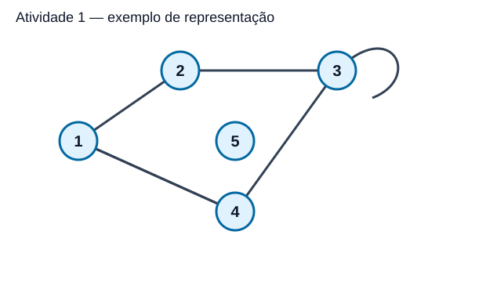
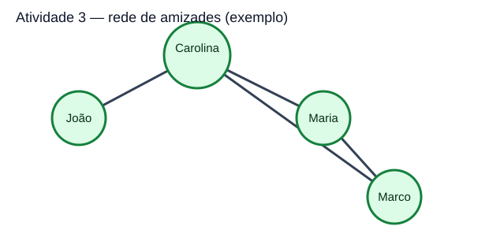
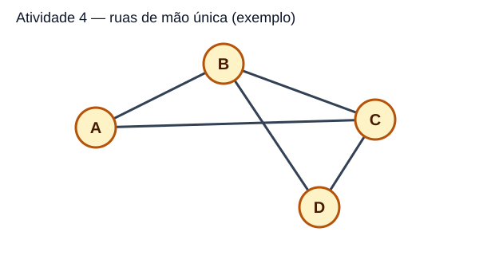
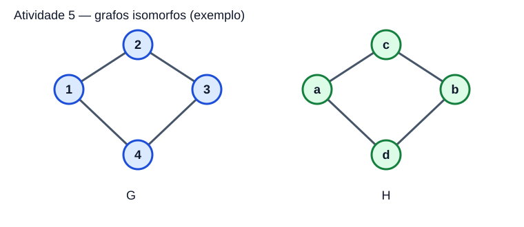
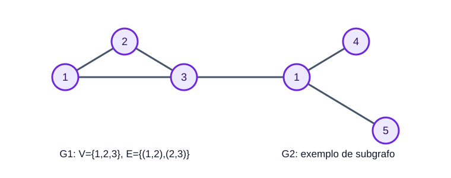
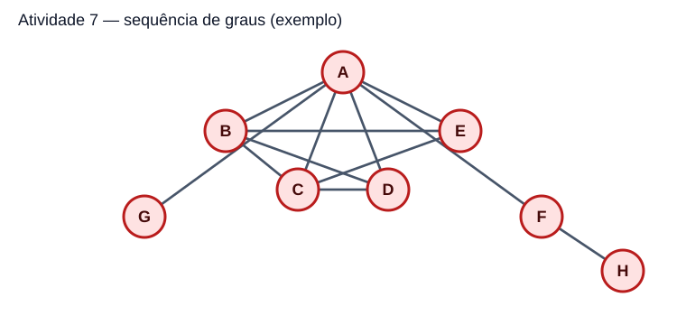

# Estrutura de Dados II — Grafos
## Unidade III — Atividades resolvidas

**Material-base:** *Material do Estudante — Prática de Grafos*, Unidade III.  
**Objetivo:** apresentar as atividades na mesma ordem do material-base, com respostas, conjuntos de vértices e arestas, cálculos e justificativas.

> **Observação importante:** algumas propostas do material deixam a escolha do grafo a cargo do estudante ou dizem que a professora fornecerá um grafo/sequência. Nesses casos, esta resolução define exemplos explícitos e coerentes para que a atividade possa ser conferida. Se a professora tiver fornecido um desenho ou uma sequência diferente, será necessário adaptar a resposta a esse enunciado específico.

---

## Atividade 1 — Desenhando um grafo

### Enunciado

Considere:

\[
V=\{1,2,3,4,5\}
\]

\[
E=\{(1,2),(1,4),(1,5),(2,3),(3,4),(4,4)\}
\]

### Respostas

**1. Número de vértices:** 5.

**2. Número de arestas:** 6.

**3. Ordem do grafo:**

\[
|V|=5
\]

**4. Tamanho do grafo:**

\[
|E|=6
\]

**5. Existe laço?** Sim. A aresta \((4,4)\) é um laço, pois começa e termina no vértice 4.

**6. Grau de cada vértice:**

| Vértice | Arestas ligadas ao vértice | Grau |
|---|---|---:|
| 1 | (1,2), (1,4), (1,5) | 3 |
| 2 | (1,2), (2,3) | 2 |
| 3 | (2,3), (3,4) | 2 |
| 4 | (1,4), (3,4), (4,4) | 4 |
| 5 | (1,5) | 1 |

O laço \((4,4)\) contribui com **2** para o grau do vértice 4. Por isso, \(\deg(4)=1+1+2=4\).

**Conferência:** a soma dos graus é \(3+2+2+4+1=12\), igual a \(2|E|=2\times6=12\).

---

## Atividade 2 — Incidência e adjacência

Usando o grafo da Atividade 1:

| Vértice | Vértices adjacentes | Arestas incidentes |
|---|---|---|
| 1 | 2, 4 e 5 | (1,2), (1,4), (1,5) |
| 2 | 1 e 3 | (1,2), (2,3) |
| 3 | 2 e 4 | (2,3), (3,4) |
| 4 | 1, 3 e 4 | (1,4), (3,4), (4,4) |
| 5 | 1 | (1,5) |

**1. Exemplo de vértices adjacentes:** 1 e 2 são adjacentes porque existe a aresta \((1,2)\) ligando-os.

**2. Exemplo de vértices não adjacentes:** 2 e 5 não são adjacentes porque não existe aresta entre eles.

**3. Diferença entre adjacência e incidência:** dois vértices são adjacentes quando existe uma aresta entre eles. Uma aresta é incidente em um vértice quando esse vértice é uma de suas extremidades. O laço \((4,4)\) é incidente no vértice 4 e conta duas vezes no grau desse vértice.

---

## Atividade 3 — Modelagem de uma rede de amizades

Como o enunciado permite criar a rede, considere a seguinte proposta de exemplo.

### 1. Conjunto de vértices

\[
V=\{\text{João, Carolina, Maria, Marco}\}
\]

### 2. Conjunto de arestas

\[
E=\{(\text{João, Carolina}), (\text{Carolina, Maria}), (\text{Carolina, Marco}), (\text{Maria, Marco})\}
\]

Cada aresta representa uma amizade entre duas pessoas.

### 3. O grafo é dirigido ou não dirigido?

É **não dirigido**, pois, neste modelo, a amizade é considerada recíproca: se João é amigo de Carolina, a relação é representada sem seta.

### 4. Grau de cada pessoa

| Pessoa | Pessoas amigas representadas no grafo | Grau |
|---|---|---:|
| João | Carolina | 1 |
| Carolina | João, Maria e Marco | 3 |
| Maria | Carolina e Marco | 2 |
| Marco | Carolina e Maria | 2 |

**Resposta:** Carolina possui o maior grau, igual a 3, pois está ligada a três pessoas.

**O que representam os vértices e as arestas?** Os vértices representam as pessoas; as arestas representam as relações de amizade escolhidas para esse exemplo.

---

## Atividade 4 — Modelagem de ruas de mão única

Para construir uma resposta completa, considere quatro cruzamentos, identificados por A, B, C e D. Neste exemplo, o vértice B representa o ponto chamado **Rua das Flores** no enunciado.

### 1. Conjunto de vértices

\[
V=\{A,B,C,D\}
\]

### 2. Conjunto de arestas dirigidas

\[
E=\{(A,B),(B,C),(B,D),(C,A),(D,C)\}
\]

A notação \((X,Y)\) indica uma rua cujo sentido permitido vai de X para Y.

### 3. Grau de entrada e grau de saída de B

- **Grau de entrada:** 1, pois apenas a aresta \((A,B)\) chega a B.
- **Grau de saída:** 2, pois as arestas \((B,C)\) e \((B,D)\) saem de B.

Logo, para B, \(d^-(B)=1\) e \(d^+(B)=2\).

### 4. Por que o grafo deve ser dirigido?

Porque as ruas são de mão única. A direção da aresta informa o sentido permitido do deslocamento. Um grafo não dirigido não registra essa restrição de sentido e, portanto, não representa adequadamente a situação.

**Conferência:** há 4 vértices e 5 arestas, como solicitado no registro do material-base.

---

## Atividade 5 — Desafio de isomorfismo

### 1. Definição dos grafos

Para o grafo G:

\[
V(G)=\{1,2,3,4\}
\]

\[
E(G)=\{(1,2),(2,3),(3,4),(4,1)\}
\]

Para o grafo H:

\[
V(H)=\{a,b,c,d\}
\]

\[
E(H)=\{(a,c),(c,b),(b,d),(d,a)\}
\]

### 2. Ordem, tamanho e graus

Ambos têm 4 vértices e 4 arestas:

\[
|V(G)|=|V(H)|=4,\quad |E(G)|=|E(H)|=4
\]

Todos os vértices de ambos os grafos têm grau 2. Portanto, as sequências de graus são iguais:

\[
(2,2,2,2)
\]

### 3. Correspondência entre os vértices

| Vértice de G | Vértice correspondente de H |
|---|---|
| 1 | a |
| 2 | c |
| 3 | b |
| 4 | d |

### 4. Verificação das arestas

| Aresta de G | Aresta correspondente em H | Existe em H? |
|---|---|---|
| (1,2) | (a,c) | Sim |
| (2,3) | (c,b) | Sim |
| (3,4) | (b,d) | Sim |
| (4,1) | (d,a) | Sim |

A correspondência utiliza cada vértice de H uma única vez e preserva todas as arestas.

### 5. Conclusão

**G e H são isomorfos neste exemplo**, porque existe uma correspondência bijetiva entre seus vértices que preserva as adjacências. Os rótulos e a aparência do desenho podem ser diferentes, mas a estrutura é a mesma.

**Atenção:** ter a mesma sequência de graus, por si só, não garante isomorfismo. Por exemplo, o ciclo \(C_6\) e a união de dois triângulos separados têm ambos seis vértices de grau 2, mas não são isomorfos: o ciclo é conexo, enquanto o grafo com dois triângulos tem duas componentes conexas.

> Se os grafos efetivamente entregues pela professora forem diferentes dos definidos acima, a conclusão deve ser verificada usando as arestas desses grafos reais.

---

## Atividade 6 — Construindo subgrafos

Para deixar o exercício verificável, vamos construir dois subgrafos a partir do grafo da Atividade 1.

O grafo original tem:

\[
V=\{1,2,3,4,5\}
\]

\[
E=\{(1,2),(1,4),(1,5),(2,3),(3,4),(4,4)\}
\]

### Subgrafo G1

\[
V(G_1)=\{1,2,3\}
\]

\[
E(G_1)=\{(1,2),(2,3)\}
\]

As arestas escolhidas pertencem ao grafo original e suas extremidades estão em \(V(G_1)\). Portanto, G1 é um subgrafo de G.

### Subgrafo G2

\[
V(G_2)=\{1,4,5\}
\]

\[
E(G_2)=\{(1,4),(1,5)\}
\]

As arestas escolhidas também pertencem ao grafo original e têm ambas as extremidades em \(V(G_2)\). Portanto, G2 também é um subgrafo de G.

**Conclusão:** G1 e G2 são subgrafos diferentes do grafo da Atividade 1. A professora pode exigir outros subgrafos se tiver indicado um grafo original diferente.

---

## Atividade 7 — Desafio da sequência de graus

O texto-base não informa numericamente a sequência a ser construída. Para manter a resolução consistente com o desafio já registrado no arquivo de apoio da pasta, usamos a sequência:

\[
(1,1,2,3,3,4,4,6)
\]

### 1. Conjunto de vértices

\[
V=\{A,B,C,D,E,F,G,H\}
\]

### 2. Conjunto de arestas

\[
\begin{aligned}
E=\{ &(A,B),(A,C),(A,D),(A,E),(A,F),(A,G),\\
&(B,C),(B,D),(B,E),(C,D),(C,E),(F,H)\}
\end{aligned}
\]

O grafo não possui laços nem arestas repetidas, portanto é um grafo simples.

### 3. Grau de cada vértice

| Vértice | Vizinhos | Grau |
|---|---|---:|
| A | B, C, D, E, F, G | 6 |
| B | A, C, D, E | 4 |
| C | A, B, D, E | 4 |
| D | A, B, C | 3 |
| E | A, B, C | 3 |
| F | A, H | 2 |
| G | A | 1 |
| H | F | 1 |

### 4. Sequência de graus em ordem não decrescente

Ordenando os graus do menor para o maior:

\[
\boxed{(1,1,2,3,3,4,4,6)}
\]

A sequência obtida corresponde à sequência solicitada nesta versão do desafio.

### 5. Verificação pelo lema do aperto de mãos

A soma dos graus é:

\[
1+1+2+3+3+4+4+6=24
\]

O grafo possui 12 arestas. Assim:

\[
2|E|=2\times12=24
\]

Como a soma dos graus é igual a duas vezes o número de arestas, a conferência está correta.

---

## Checklist final

- [x] Vértices, arestas, ordem e tamanho identificados na Atividade 1.
- [x] Laço contado duas vezes no grau do vértice 4.
- [x] Adjacência e incidência diferenciadas na Atividade 2.
- [x] Rede de amizades definida e justificada na Atividade 3.
- [x] Grafo dirigido de ruas de mão única definido na Atividade 4.
- [x] Isomorfismo demonstrado por correspondência e verificação de arestas na Atividade 5.
- [x] Dois subgrafos válidos construídos na Atividade 6.
- [x] Sequência de graus conferida pela soma dos graus e pelo número de arestas na Atividade 7.

---

## Referência do material-base

GOMES, Paulo César Rodacki. **Grafos: conceitos fundamentais, algoritmos e aplicações**. Blumenau: Editora IFC, 2022. Material de apoio indicado no documento da Unidade III.
