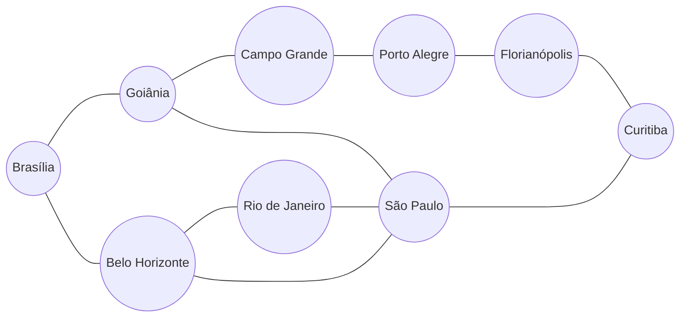

# Grafos, BFS e DFS: conectividade em uma rede fictícia de cidades

**Disciplina:** Estrutura de Dados II (Ciência da Computação)  
**Estudante:** Gustavo Alves  
**Material:** [Material do Estudante: Grafos, BFS e DFS](Material_Estudante_Grafos_BFS_DFS.md)  
**Referência principal:** GOMES, Paulo César Rodacki. *Grafos: conceitos fundamentais, algoritmos e aplicações*. Blumenau: Editora IFC, 2022.

> **Importante:** esta atividade é uma simulação computacional, e não um modelo de navegação aeronáutica. A notícia da pane de GPS no Aeroporto de Brasília (G1, 22 set. 2026) motiva o problema, mas a rede, as conexões e os bloqueios são **fictícios**. O resultado não pode ser usado para orientar voos reais.

## 1. Problema e objetivo

Uma indisponibilidade de recursos de navegação pode obrigar a replanejar rotas. Para estudar esse tipo de situação, a rede é modelada como um grafo e são comparados dois algoritmos de busca, a BFS (busca em largura) e a DFS (busca em profundidade).

**Pergunta de pesquisa:** *quantas conexões da rede precisam ser bloqueadas para que Brasília deixe de alcançar Curitiba, e como a BFS e a DFS se comportam a cada bloqueio?*

**Objetivo:** projetar um grafo próprio com pelo menos sete vértices, implementar BFS e DFS em Python, simular bloqueios de conexões sem alterar a rede original e justificar os resultados.

## 2. Modelagem do grafo

Grafo simples, **não dirigido** e **não ponderado**, `G = (V, E)`:

- cada vértice em `V` é uma cidade;
- cada aresta em `E` é uma ligação permitida nos dois sentidos;
- não há laços nem conexões repetidas (o programa rejeita laços e ignora repetições).

**V** (9 cidades): Brasília, Goiânia, Belo Horizonte, Campo Grande, São Paulo, Rio de Janeiro, Curitiba, Porto Alegre e Florianópolis.

| # | Conexão | Justificativa (fictícia) |
|---:|---|---|
| 1 | Brasília – Goiânia | cidades vizinhas no Centro-Oeste |
| 2 | Brasília – Belo Horizonte | eixo Centro-Oeste/Sudeste |
| 3 | Goiânia – Campo Grande | corredor do Centro-Oeste |
| 4 | Goiânia – São Paulo | ligação com o principal polo do Sudeste |
| 5 | Belo Horizonte – Rio de Janeiro | eixo Minas/Rio |
| 6 | Belo Horizonte – São Paulo | eixo Minas/São Paulo |
| 7 | Rio de Janeiro – São Paulo | eixo Rio/São Paulo |
| 8 | São Paulo – Curitiba | ligação direta com o Sul |
| 9 | Campo Grande – Porto Alegre | rota alternativa pelo interior |
| 10 | Porto Alegre – Florianópolis | eixo do Sul |
| 11 | Florianópolis – Curitiba | acesso a Curitiba pelo litoral sul |

Ordem `|V| = 9` e tamanho `|E| = 11`. Soma dos graus: 2 + 3 + 3 + 2 + 4 + 2 + 2 + 2 + 2 = 22 = 2 × 11, o que confirma o Lema dos Apertos de Mão.

### Diagrama do grafo



### Lista de adjacência (a ordem dos vizinhos importa para a DFS)

```python
{
    "Brasília":       ["Goiânia", "Belo Horizonte"],
    "Goiânia":        ["Brasília", "Campo Grande", "São Paulo"],
    "Belo Horizonte": ["Brasília", "Rio de Janeiro", "São Paulo"],
    "Campo Grande":   ["Goiânia", "Porto Alegre"],
    "São Paulo":      ["Goiânia", "Belo Horizonte", "Rio de Janeiro", "Curitiba"],
    "Rio de Janeiro": ["Belo Horizonte", "São Paulo"],
    "Curitiba":       ["São Paulo", "Florianópolis"],
    "Porto Alegre":   ["Campo Grande", "Florianópolis"],
    "Florianópolis":  ["Porto Alegre", "Curitiba"],
}
```

## 3. Estrutura da solução

```
BFS_DFS/
├── solucao_grafos.py            # classe RedeDeCidades, BFS, DFS e programa principal
├── test_solucao_grafos.py       # 30 testes automatizados (unittest)
├── evidencias_testes.txt        # saída das execuções e dos testes
├── Material_Estudante_Grafos_BFS_DFS.md  # enunciado
└── README.md
```

Decisões de projeto:

- **Classe `RedeDeCidades`:** concentra a estrutura de dados e os algoritmos; a apresentação (`relatorio_cenario`, `formatar_caminho`) fica em funções separadas, e só `main` imprime.
- **Rede original imutável na prática:** `com_bloqueio` devolve uma **cópia** sem a conexão, de modo que um bloqueio nunca altera a rede original, e bloqueios podem ser encadeados.
- **Validação:** cidades inexistentes levantam `CidadeInexistenteError`, e o programa responde com mensagem de erro e código de saída 1.
- **Casos sem caminho:** as buscas devolvem `None`, tratado na apresentação como "sem caminho".
- **Sem dependências externas:** só a biblioteca padrão. O NetworkX é usado apenas nos testes, como referência, e esses testes são ignorados se ele não estiver instalado.
- **Documentação:** *docstrings*, *type hints* e nomes descritivos.

## 4. Como executar

Requer Python 3.8 ou superior. Dentro desta pasta:

```bash
python solucao_grafos.py                                   # cenários padrão
python solucao_grafos.py --origem Brasília --destino "Porto Alegre"
python solucao_grafos.py --bloquear "Goiânia-São Paulo"    # um ou mais bloqueios
python solucao_grafos.py --bloquear "Brasília-Goiânia" --bloquear "Brasília-Belo Horizonte"
python -m unittest -v                                      # testes
```

Sem `--origem` e `--destino`, quando executado em um terminal, o programa pergunta as cidades e repete a pergunta enquanto o nome não existir na rede. Fora de um terminal, usa Brasília e Curitiba.

## 5. Complexidade

| Operação | Tempo | Memória |
|---|---|---|
| BFS e DFS | O(V + E) | O(V) (a fila ou a pilha guarda caminhos de até V cidades) |
| `com_bloqueio` (cópia) | O(V + E) | O(V + E) |
| `conjuntos_de_corte` (força bruta, k conexões) | O(C(E, k) · (V + E)) | O(V + E) |

A força bruta só é viável porque a rede é pequena.

## 6. Experimentos (Brasília → Curitiba)

| Experimento | Cenário | BFS | DFS |
|---|---|---|---|
| **A** | rede completa | Brasília → Goiânia → São Paulo → Curitiba (**3** arestas) | Brasília → Goiânia → Campo Grande → Porto Alegre → Florianópolis → Curitiba (**5** arestas) |
| **B** | bloqueio de Goiânia–São Paulo | Brasília → Belo Horizonte → São Paulo → Curitiba (**3** arestas) | igual ao de A (**5** arestas) |
| **B'** | bloqueio de São Paulo–Curitiba | Brasília → Goiânia → Campo Grande → Porto Alegre → Florianópolis → Curitiba (**5** arestas) | igual (**5** arestas) |
| **C1** | bloqueio de Goiânia–São Paulo e Belo Horizonte–São Paulo | Brasília → Belo Horizonte → Rio de Janeiro → São Paulo → Curitiba (**4** arestas) | igual ao de A (**5** arestas) |
| **C2** | bloqueio de Brasília–Goiânia e Brasília–Belo Horizonte | sem caminho | sem caminho |
| **D** | vizinhos de Goiânia em outra ordem (São Paulo antes de Campo Grande), sem mudar o grafo | 3 arestas (não muda) | Brasília → Goiânia → São Paulo → Curitiba (**3** arestas) |

**Experimento C (conectividade):** nenhum bloqueio isolado separa Brasília de Curitiba, pois o grafo tem vários caminhos entre as duas. Em C2, porém, as duas conexões de Brasília são bloqueadas e ela fica **sem nenhuma aresta**, então qualquer busca termina sem alcançar Curitiba: o grafo deixa de ser conexo.

**Conjuntos mínimos de duas conexões que isolam Brasília de Curitiba** (encontrados por força bruta, e a conectividade por arestas 2 foi conferida com o NetworkX nos testes):

1. Brasília–Goiânia e Brasília–Belo Horizonte
2. Goiânia–Campo Grande e São Paulo–Curitiba
3. Campo Grande–Porto Alegre e São Paulo–Curitiba
4. São Paulo–Curitiba e Curitiba–Florianópolis
5. São Paulo–Curitiba e Porto Alegre–Florianópolis

**Resposta à pergunta de pesquisa:** com **uma** conexão bloqueada, Brasília sempre alcança Curitiba; com **duas**, pode deixar de alcançar (cinco combinações acima). A rede tolera qualquer falha isolada, mas não qualquer par de falhas. A conexão **São Paulo–Curitiba** é a mais crítica: aparece em quatro dos cinco conjuntos, e sem ela o trajeto passa de 3 para 5 arestas.

## 7. Comparação entre BFS e DFS

| Aspecto | BFS | DFS |
|---|---|---|
| Estrutura | fila FIFO (`deque`) | pilha LIFO (lista) |
| Caminho achado | o de **menor número de arestas** (grafo não ponderado) | um caminho qualquer, que depende da ordem dos vizinhos |
| Experimento A | 3 arestas | 5 arestas |
| Tempo | O(V + E) | O(V + E) |
| Memória | pode guardar uma "camada" inteira da fila | em geral guarda menos vértices ao mesmo tempo |
| Quando usar | menor número de conexões, distância em arestas | só verificar se há caminho, explorar a estrutura, achar componentes |

As duas buscas concordam **sempre** sobre a *existência* de caminho (testado em todas as combinações de dois bloqueios), mas só a BFS garante o menor.

## 8. Limitações

- O grafo é **não ponderado**: "menor" quer dizer menos arestas, e não menor tempo, distância ou combustível. Para isso seria preciso um grafo ponderado (por exemplo, com o algoritmo de Dijkstra).
- A rede é pequena e fictícia; não modela voos, capacidades, horários, janelas de operação nem regras da aviação.
- As conexões são simétricas, enquanto rotas reais podem ser diferentes em cada sentido (grafo dirigido).
- Bloquear uma conexão é uma hipótese didática, e não uma consequência comprovada da pane relatada.
- A busca de conjuntos de corte por força bruta não escala para redes grandes.

## 9. Questões para reflexão

1. **Por que um grafo representa melhor a rede de conexões do que uma árvore binária?** Uma árvore binária não tem ciclos e cada nó tem um único pai e no máximo dois filhos. Uma rede de cidades tem ciclos (São Paulo–Rio–Belo Horizonte), cidades com mais de duas ligações e vários caminhos entre o mesmo par, o que só um grafo expressa.
2. **Em qual condição a BFS encontra o menor caminho? O que significa "menor"?** Em grafos não ponderados (ou com pesos iguais). "Menor" é o menor número de arestas, e não menor tempo ou distância.
3. **Por que a DFS pode retornar um caminho diferente da BFS?** Porque ela aprofunda o primeiro ramo disponível antes de voltar, e o ramo escolhido depende da ordem dos vizinhos. No experimento D, só a ordem muda e a DFS passa de 5 para 3 arestas.
4. **O que ocorre se não utilizarmos um conjunto de visitados?** Em grafos com ciclos, as buscas voltam a vértices já explorados e podem repetir o trabalho indefinidamente, sem terminar quando o destino é inalcançável. O teste `test_rede_com_ciclo_nao_entra_em_laco_infinito` cobre esse cuidado.
5. **Que informações adicionais seriam necessárias para avaliar tempo ou custo de uma rota?** Pesos nas arestas (distância, duração, custo), horários e capacidade dos voos, tempo de conexão e restrições de operação.
6. **Por que o resultado não pode orientar um voo real?** Porque o modelo é fictício e simplificado, sem as variáveis operacionais e de segurança da navegação aérea.

## 10. Testes

`python -m unittest -v` executa **30 testes** (saída completa em [evidencias_testes.txt](evidencias_testes.txt)), organizados em:

- **Construção:** ordem, tamanho, reciprocidade das conexões, Lema dos Apertos de Mão, repetição, laço e cidade inexistente.
- **Buscas:** menor caminho da BFS, caminho válido (porém mais longo) da DFS, efeito da ordem dos vizinhos, origem igual ao destino e alcance de todas as cidades.
- **Bloqueios:** a rede original não é alterada, remoção nos dois sentidos, nenhum bloqueio isolado separa Brasília de Curitiba, dois bloqueios podem separar e os cinco conjuntos mínimos de corte.
- **Casos de borda:** rede desconexa e rede com ciclos.
- **Programa:** execução padrão, origem inexistente (código de saída 1), bloqueios informados pelo usuário, formato inválido e pergunta repetida até o nome existir.
- **Referência:** comparação das distâncias de todos os pares e da conectividade por arestas com o NetworkX (ignorada se ele não estiver instalado).

## 11. Roteiro sugerido para a apresentação de 5 minutos

1. **Problema (30 s):** pane de GPS como motivação e a pergunta de pesquisa.
2. **Modelo (1 min):** grafo não dirigido, 9 cidades e 11 conexões, lista de adjacência e o diagrama.
3. **Algoritmos (1 min):** BFS com fila e DFS com pilha, e o papel do conjunto de visitados.
4. **Demonstração (1 min 30 s):** `python solucao_grafos.py`, os bloqueios e o caso sem caminho.
5. **Conclusões (1 min):** BFS dá o menor caminho e a DFS não; a rede suporta uma falha, mas não duas; limitações.

## Referências

GOMES, Paulo César Rodacki. **Grafos: conceitos fundamentais, algoritmos e aplicações**. Blumenau: Editora IFC, 2022. ISBN 978-65-88089-12-5. (Capítulos 1, 2 e 3.)

G1 DISTRITO FEDERAL. **Pane em GPS afeta voos da Azul no Aeroporto de Brasília; passageiros reclamam de atrasos**. 22 set. 2026. Disponível em: https://g1.globo.com/df/distrito-federal/noticia/2026/09/22/pane-em-gps-afeta-voos-da-azul-no-aeroporto-de-brasilia-passageiros-reclamam-de-atrasos.ghtml.
