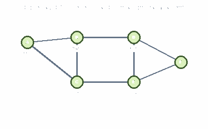
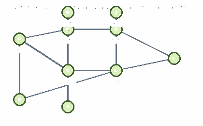

# Projeto ConectaUDF: Redes Sociais, Grafos e Cálculos

**Curso:** Ciência da Computação

## 1. Introdução

Os grafos representam elementos e as relações entre eles. Nesta atividade, os usuários de uma rede social são vértices e as amizades são arestas. A rede é um grafo simples não direcionado, sem laços e sem arestas duplicadas.

## 2. Rede inicial

Usuários: Ana, Bruno, Carla, Diego, Elisa e Felipe.

Amizades:
- Ana — Bruno
- Ana — Carla
- Bruno — Carla
- Bruno — Diego
- Carla — Elisa
- Diego — Elisa
- Diego — Felipe
- Elisa — Felipe

### Grafo da rede inicial



Conjunto de vértices:

\[
V=\{A,B,C,D,E,F\}
\]

Conjunto de arestas:

\[
E=\{(A,B),(A,C),(B,C),(B,D),(C,E),(D,E),(D,F),(E,F)\}
\]

### Lista de adjacência

```text
Ana:    Bruno, Carla
Bruno:  Ana, Carla, Diego
Carla:  Ana, Bruno, Elisa
Diego:  Bruno, Elisa, Felipe
Elisa:  Carla, Diego, Felipe
Felipe: Diego, Elisa
```

## 3. Grau dos usuários

| Usuário | Amigos diretos | Grau |
|---|---|---:|
| Ana | Bruno, Carla | 2 |
| Bruno | Ana, Carla, Diego | 3 |
| Carla | Ana, Bruno, Elisa | 3 |
| Diego | Bruno, Elisa, Felipe | 3 |
| Elisa | Carla, Diego, Felipe | 3 |
| Felipe | Diego, Elisa | 2 |

Bruno, Carla, Diego e Elisa possuem o maior grau, igual a 3.

## 4. Quantidade de arestas

A soma dos graus é:

\[
2+3+3+3+3+2=16
\]

Cada aresta é contada duas vezes na soma dos graus. Logo:

\[
|E|=\frac{16}{2}=8
\]

A rede inicial possui **8 amizades**.

## 5. Densidade da rede inicial

A fórmula da densidade de um grafo simples não direcionado é:

\[
D=\frac{2|E|}{|V|(|V|-1)}
\]

Existem 6 usuários e 8 amizades. O total de amizades possíveis é:

\[
\frac{6(6-1)}{2}=15
\]

Portanto:

\[
D=\frac{2\times8}{6(6-1)}=\frac{16}{30}\approx0{,}5333=53{,}33\%
\]

A rede contém 53,33% das conexões possíveis.

## 6. Caminhos entre Ana e Felipe

Dois caminhos mínimos são:

1. Ana → Bruno → Diego → Felipe.
2. Ana → Carla → Elisa → Felipe.

Cada caminho possui 3 arestas. Ambos são mínimos, pois Ana e Felipe não têm amizade direta nem um amigo em comum.

## 7. Código Python

```python
from collections import deque

rede = {
    "Ana": ["Bruno", "Carla"],
    "Bruno": ["Ana", "Carla", "Diego"],
    "Carla": ["Ana", "Bruno", "Elisa"],
    "Diego": ["Bruno", "Elisa", "Felipe"],
    "Elisa": ["Carla", "Diego", "Felipe"],
    "Felipe": ["Diego", "Elisa"]
}

def analisar_rede(rede):
    n = len(rede)
    graus = {usuario: len(amigos) for usuario, amigos in rede.items()}
    soma_graus = sum(graus.values())
    arestas = soma_graus // 2
    densidade = (2 * arestas) / (n * (n - 1)) if n > 1 else 0

    print("Usuários:", n)
    print("Arestas:", arestas)
    print("Soma dos graus:", soma_graus)
    print("Graus:", graus)
    print("Maior grau:", max(graus.values()))
    print("Mais conectados:", [
        u for u, g in graus.items() if g == max(graus.values())
    ])
    print("Densidade: {:.2%}".format(densidade))

def encontrar_caminho(rede, origem, destino):
    fila = deque([[origem]])
    visitados = {origem}

    while fila:
        caminho = fila.popleft()
        atual = caminho[-1]
        if atual == destino:
            return caminho
        for amigo in rede[atual]:
            if amigo not in visitados:
                visitados.add(amigo)
                fila.append(caminho + [amigo])
    return None

print("REDE INICIAL")
analisar_rede(rede)
caminho = encontrar_caminho(rede, "Ana", "Felipe")
print("Caminho mínimo:", " -> ".join(caminho))
print("Quantidade de arestas:", len(caminho) - 1)
```

O programa calcula graus, número de arestas, densidade e encontra um caminho mínimo usando busca em largura.

## 8. Ampliação da rede

Foram adicionados quatro usuários: Gabriel, Helena, Igor e Júlia.

Novas amizades:
- Ana — Gabriel
- Bruno — Helena
- Carla — Igor
- Diego — Júlia
- Elisa — Gabriel

### Grafo da rede ampliada



### Lista de adjacência atualizada

```text
Ana:     Bruno, Carla, Gabriel
Bruno:   Ana, Carla, Diego, Helena
Carla:   Ana, Bruno, Elisa, Igor
Diego:   Bruno, Elisa, Felipe, Júlia
Elisa:   Carla, Diego, Felipe, Gabriel
Felipe:  Diego, Elisa
Gabriel: Ana, Elisa
Helena:  Bruno
Igor:    Carla
Júlia:   Diego
```

### Graus da rede ampliada

| Usuário | Grau |
|---|---:|
| Ana | 3 |
| Bruno | 4 |
| Carla | 4 |
| Diego | 4 |
| Elisa | 4 |
| Felipe | 2 |
| Gabriel | 2 |
| Helena | 1 |
| Igor | 1 |
| Júlia | 1 |

A soma dos graus é 26, portanto o número de arestas é 26 / 2 = **13**.

O máximo de amizades possíveis entre 10 usuários é:

\[
\frac{10(10-1)}{2}=45
\]

A densidade é:

\[
D=\frac{2\times13}{10(10-1)}=\frac{26}{90}\approx28{,}89\%
\]

## 9. Comparação

| Métrica | Rede inicial | Rede ampliada |
|---|---:|---:|
| Usuários | 6 | 10 |
| Amizades | 8 | 13 |
| Soma dos graus | 16 | 26 |
| Amizades possíveis | 15 | 45 |
| Densidade | 53,33% | 28,89% |
| Maior grau | 3 | 4 |

A quantidade de amizades aumentou, mas a densidade diminuiu porque o número de conexões possíveis cresceu proporcionalmente mais.

## 10. Análise

**1. Quem tem mais conexões na rede inicial?**  
Bruno, Carla, Diego e Elisa, com 3 conexões cada.

**2. Mais conexões significam maior influência?**  
Não necessariamente. O grau mede apenas conexões diretas; a influência depende de outros fatores da rede.

**3. Como a densidade ajuda na análise?**  
Indica a proporção das amizades existentes em relação ao total possível.

**4. Como sugerir novas amizades?**  
Uma plataforma pode recomendar usuários que compartilham amigos em comum, sem presumir que eles necessariamente desejem se conectar.

**5. Quais cuidados de privacidade são importantes?**  
Proteger dados pessoais, limitar acesso, respeitar consentimento e não expor relações sem autorização.

**6. A densidade sempre aumenta quando adicionamos usuários e amizades?**  
Não. Nesta ampliação, a densidade caiu de 53,33% para 28,89%, pois as conexões possíveis cresceram mais do que as amizades existentes.

## 11. Conclusão

O projeto demonstrou como os grafos representam redes sociais e permitem analisar conexões entre usuários. Os cálculos de grau, arestas e densidade ajudam a compreender a estrutura da rede, enquanto o Python automatiza parte da análise e encontra caminhos mínimos. A ampliação mostrou que aumentar o número de amizades não significa necessariamente aumentar a densidade. A análise de redes também deve respeitar a privacidade dos usuários.
